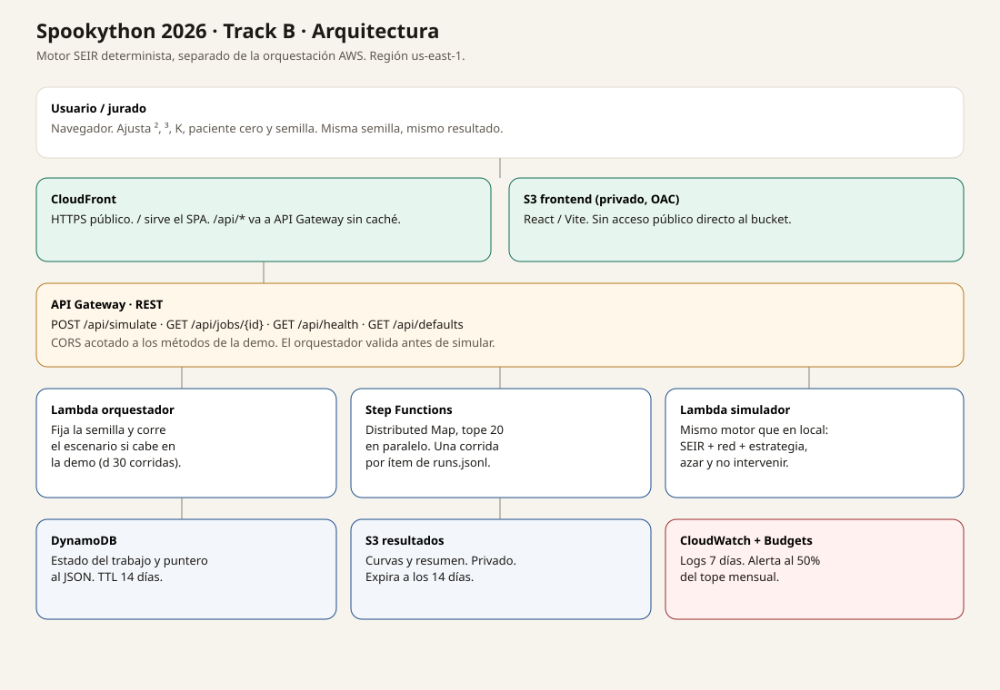
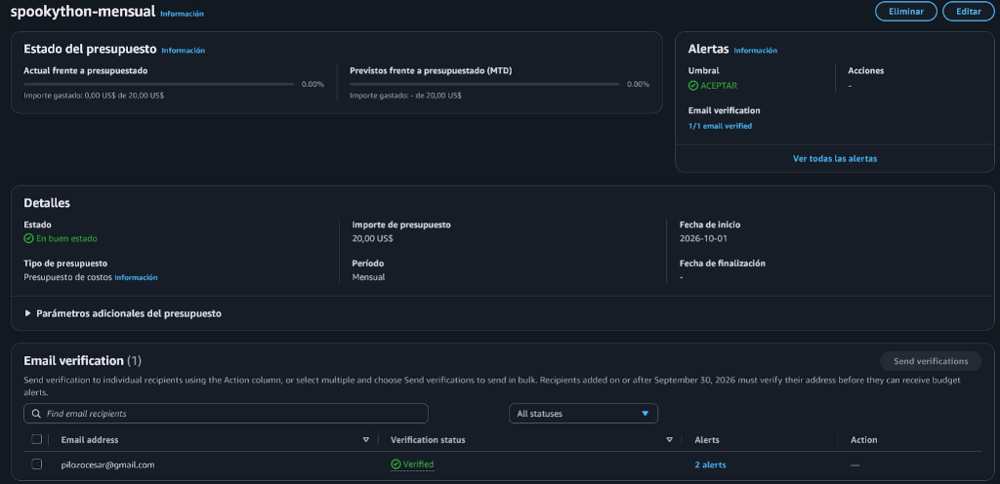

# Spookython 2026 — Track B · La plaga zombie: CORDYCEPS (The Last of Us)

> 🌐 **App Desplegada en Producción (AWS CloudFront):**  
> **[https://d30ze7fyeksj6z.cloudfront.net/](https://d30ze7fyeksj6z.cloudfront.net/)**  
> *(Acceso público oficial para la evaluación del jurado, operativo y funcional).*

Mesa del Comité de Contención Epidemiológica para Manta frente al brote de la **Infección Cerebral por Cordyceps (CBI - The Last of Us)**. Simula día a día la propagación por mordeduras y esporas fúngicas sobre una red de hogares, aulas, buses y mercados, determinando científicamente a quién cubrir primero cuando los recursos y dosis de antígeno son limitados.

La estrategia se compara rigurosamente contra dos líneas base bajo la **misma semilla** y la **misma suerte de transmisión**: no intervenir, y gastar el mismo presupuesto al azar. El motor es determinista y matemáticamente reproducible.



---

## 🚀 1. Ejecución Directa de la UI (1 solo comando)

Para ejecutar el proyecto y abrir la interfaz de contención directamente en tu navegador (sin necesidad de Node.js):

```bash
python run.py
```

Esto iniciará el servidor local y abrirá automáticamente la aplicación interactiva en **`http://127.0.0.1:8000/`**.

> También puedes ejecutar la suite de pruebas unitarias con:
> ```bash
> python -m pytest
> ```

---

## 🧬 2. Calibración del Escenario: Cordyceps (The Last of Us)

El reto permite modelar una plaga inspirada en la ficción o en la realidad. Se ha adaptado el escenario completo a la **Infección Cerebral por Cordyceps (CBI)** de *The Last of Us*:

* **Patógeno:** Mutación mamífera de *Ophiocordyceps unilateralis*. Crece alrededor del sistema nervioso central del huésped, tomando sus funciones motoras.
* **Mecanismos de Transmisión en Manta:**
  * **Mordeduras directas intrafamiliares:** Peso `1.0` en hogares.
  * **Esporas fúngicas en espacios cerrados:** Peso ajustado en transporte público (buses interparroquiales), aulas escolares cerradas (UE Manta, Tarqui) y bodegas densas del Mercado Central y de Tarqui.
* **Estados Epidemiológicos SEIR:**
  * **S (Sano / Susceptible):** Habitantes no expuestos del cantón Manta.
  * **E (Mordido / Esporas en Incubación):** Infección fúngica latente durante ~24 a 48 horas ($\sigma = 0.50$). Aún no contagia ni muestra agresividad externa.
  * **I (Infectado CBI Activo — Runners / Clickers):** Fase infecciosa agresiva ($\gamma = 0.25$, media ~4 días activos hasta contención o neutralización).
  * **R (Inmune / Tratamiento Fúngico):** Inmunoterapia sintetizada de antígenos fúngicos (inmunidad tipo Ellie / Comité) o aislamiento efectivo.

| Parámetro | Valor por defecto | Significado en el escenario Cordyceps |
| --- | --- | --- |
| Semilla | `42` | Fija la red de Manta, el paciente cero y la secuencia pseudoaleatoria |
| Muestra | 480 personas | Muestra estadística representativa (Censo INEC 2022) |
| Días | 40 días | Horizonte temporal de la simulación |
| β (Contagio) | 0,16 | Probabilidad de transmisión por mordedura / espora |
| σ (Incubación) | 0,50 | Fase latente antes de manifestar CBI (Media ≈ 2 días) |
| γ (Recuperación) | 0,25 | Días de fase infecciosa activa (Media ≈ 4 días) |
| Presupuesto K | 40 dosis | Dosis de antígeno o cordones sanitarios (**solo sobre sanos**) |
| Eficacia | 1,0 (100%) | Inmunidad fúngica total. Brote sorpresa evalúa mutaciones al 60% |
| Criterio | Anillo | Anillo del caso cero (hogar y contactos directos) + hubs de grado |
| Corridas | 8 | Corridas Monte Carlo con media, percentil 5 (p05) y percentil 95 (p95) |

β, σ y γ salen de `src/engine/config.py` (`beta = 0.16`, `sigma = 0.5`, `gamma = 0.25`). El origen de esos tres parámetros y de los costos 25 / 15 / 200 USD está en la sección 6: son un supuesto del equipo, no un dataset citado. INEC solo respalda población, hogares y la fracción de 0 a 14 años.

---

## 🌟 3. Resumen de Cambios Aplicados (Nivel Base + Nivel PRO)

Se implementaron de forma estructurada y modular todos los requisitos faltantes del reto:

### A. Interfaz Gráfica Directa (UI)
* **Archivo:** `src/api/static/index.html` servido en `GET /` y `GET /app` por FastAPI.
* **Ventaja:** Permite evaluar inmediatamente el proyecto sin necesidad de entornos Node/npm.
* **Estilo:** Tema táctil oscuro postapocalíptico inspirado en FEDRA y Zonas de Cuarentena (ZQ) de *The Last of Us*, con controles deslizantes en vivo, tarjetas KPI, gráficos SVG interactivos y selector de pestañas.

### B. Análisis Territorial por Parroquias de Manta (Nivel PRO)
* **Archivos:** `src/engine/seir.py` y `src/engine/compare.py`.
* **Funcionalidad:** Monitoreo diario del avance de infectados activos en las 5 parroquias reales de Manta: *Manta Centro, Tarqui, Eloy Alfaro, San Mateo y San Lorenzo*.
* **Semáforo Epidemiológico:** Clasifica el riesgo territorial en *Controlado*, *Alerta* o *Crítico*, visibilizando el rol del Mercado de Tarqui como hub comercial.

### C. Modelo Económico y Retorno de Inversión (Nivel PRO)
* **Archivo:** `src/engine/compare.py` (`_calcular_economia`).
* **Costos unitarios (supuesto del equipo, no un dataset citado):** \$25 USD por dosis de vacuna, \$15 USD por cuarentena y \$200 USD por caso. Están fijos en `src/engine/compare.py` (`_calcular_economia`). El detalle está en la sección 6. No es el estimado AWS de `docs/costos.md` (\$5 a \$15 al mes).
* **Métricas:** Calcula la inversión de la intervención, costo total sin intervención, ahorro económico neto para el Municipio y Retorno de Inversión (ROI).

### D. Dictamen Ejecutivo Oficial para el Alcalde (Nivel PRO)
* **Archivo:** `src/engine/compare.py` (`_informe_ejecutivo`).
* **Funcionalidad:** Generación automática de un memorando formal para el Alcalde del Cantón Manta y el COE Cantonal, redactado en lenguaje simple con diagnóstico, vidas salvadas, balance financiero y 3 directrices operativas inmediatas.
* **Acciones en UI:** Botón de copiado en 1 clic y opción de impresión/exportación a PDF.

### E. Presets para la Prueba de Fuego (Brote Sorpresa)
* **Botones interactivos en la UI:**
  * 🍄 **Doble Contagio:** Duplica $\beta$ para simular brote masivo de esporas.
  * 📉 **Mitad de Dosis:** Reduce $K$ al 50% por escasez de suministros.
  * 🏬 **Brote en Mercado:** Sitúa el foco inicial en el Mercado de Tarqui.
  * 🧬 **Mutación Fúngica:** Reduce la eficacia de la vacuna al 60%.

### F. Blindaje Anti-Red Flags del Jurado
* **Validación algorítmica:** El selector de nodos garantiza que **0 personas infectadas o inmunes sean vacunadas**.
* **Comparación obligatoria:** Todo resultado contrasta la estrategia contra **No Intervenir** y **Azar con el mismo K**.

---

## 🏛️ 4. Estructura de Archivos y Arquitectura

El proyecto organiza sus capas de forma desacoplada para garantizar que el motor matemático sea determinista, portable e independiente de la nube:

```
Spookython-TRACK-B/
│
├── run.py                     # [NUEVO] Lanzador directo de la UI en 1 paso
├── README.md                  # Documentación integral del proyecto
├── Makefile                   # Automatización de tareas locales
├── pyproject.toml             # Configuración de herramientas y pytest
├── requirements.txt           # Dependencias de producción (numpy, networkx, fastapi, uvicorn)
├── requirements-dev.txt       # Dependencias de desarrollo y test (pytest, httpx)
│
├── docs/                      # Documentación y diagramas
│   ├── arquitectura.svg       # Diagrama de arquitectura AWS
│   ├── arquitectura.drawio    # Fuente editable del diagrama
│   ├── costos.md              # Declaración de costos mensualizados AWS
│   ├── budget.png             # Evidencia de AWS Budgets
│   ├── pitch.pdf              # [NUEVO] Diapositivas oficiales del Pitch en PDF (16:9, máx 20 MB)
│   └── pitch_guion.md         # [NUEVO] Guion verbal cronometrado a 5 min y defensa Q&A
│
├── src/
│   ├── api/                   # Capa de Servicio Web (FastAPI)
│   │   ├── main.py            # Rutas HTTP (/health, /defaults, /simulate, / y /app)
│   │   └── static/
│   │       └── index.html     # [NUEVO] UI directa interactiva con tema Cordyceps
│   │
│   ├── engine/                # Motor Epidemiológico Determinista (Python puro)
│   │   ├── config.py          # Dataclass de parámetros y validación
│   │   ├── network.py         # Grafo sintético de Manta (hogares, aulas, buses, mercados)
│   │   ├── seir.py            # Simulación diaria S->E->I->R y tracking territorial
│   │   ├── strategies.py      # Algoritmos de selección (anillo, grado, puentes, betweenness)
│   │   └── compare.py         # Monte Carlo, economía, informe ejecutivo y huella SHA-256
│   │
│   └── lambdas/               # Handlers para despliegue Serverless en AWS
│       ├── orchestrator/      # Lambda orquestador síncrono para demo
│       ├── simulator/         # Lambda de simulación individual para Distributed Map
│       └── aggregator/        # Lambda agregador de resultados de Step Functions
│
├── infra/                     # Infraestructura como Código (IaC)
│   ├── template.yaml          # Plantilla AWS SAM completa (API GW, Lambdas, S3, DynamoDB)
│   └── statemachine.asl.json  # Definición Step Functions para Monte Carlo masivo
│
├── frontend/                  # SPA React alternativa (Vite + TypeScript)
│   ├── src/
│   │   ├── App.tsx            # Componente principal React con tema Cordyceps
│   │   ├── Chart.tsx          # Gráficos SVG en React
│   │   └── types.ts           # Definiciones TypeScript sincronizadas con el motor
│   └── package.json
│
└── tests/                     # Suite de Pruebas Automatizadas
    ├── test_api.py            # Pruebas de endpoints FastAPI y UI
    ├── test_engine.py         # Pruebas matemáticas de reproducibilidad y SEIR
    └── test_handlers.py       # Pruebas de integración de Lambdas AWS
```

---

## ☁️ 5. Despliegue en AWS (us-east-1)

* 🌐 **URL Pública Operativa:** **[https://d30ze7fyeksj6z.cloudfront.net/](https://d30ze7fyeksj6z.cloudfront.net/)**

La arquitectura desacoplada permite ejecutar el sistema en local o desplegarlo en AWS mediante AWS SAM:

| Componente AWS | Rol en la Arquitectura |
| --- | --- |
| **Amazon S3 + CloudFront** | Aloja y distribuye la interfaz web estática de forma pública y segura (OAC). |
| **API Gateway** | Expone la API REST (`/api/simulate`). La plantilla deja el origen abierto (`AllowOrigin: '*'`, `CORS_ORIGIN: "*"`) hasta fijar el hostname de CloudFront. |
| **AWS Lambda (Orquestador)** | Procesa solicitudes síncronas de la prueba en vivo en < 2 segundos. |
| **AWS Step Functions + Lambda Simulator** | Orquestación paralela para corridas masivas Monte Carlo (Distributed Map). |
| **Amazon DynamoDB & Amazon S3** | Persistencia de resultados, trazabilidad y huellas con TTL de 14 días. |
| **AWS Budgets & CloudWatch** | Alerta temprana de presupuesto fijada en \$20 USD/mes desde el primer día. |

Para compilar y desplegar con AWS SAM:

```bash
sam build -t infra/template.yaml
sam deploy -t infra/template.yaml --guided --region us-east-1 \
  --parameter-overrides AlertEmail=tu-correo@ejemplo.com MonthlyBudgetUsd=20
```

### 💰 Resumen de Declaración de Costos (Rúbrica Oficial)
* **Gasto Real Acumulado del Evento:** **\$0,00 USD** (100% cubierto por AWS Free Tier — evidencia en `docs/budget.png`).
* **Estimado Mensual Operativo:** **\$5 a \$15 USD / mes** (100% Serverless bajo demanda, sin costos fijos).
* **Alerta de Seguridad (AWS Budgets):** Activa en **\$20,00 USD** con alertas al 50% y 100% proyectado.
* **Detalle y Desglose por Servicio:** Ver informe completo en [docs/costos.md](docs/costos.md).



---

## 📊 6. Datos de Referencia y supuestos

- **INEC, Censo 2022:** Cantón Manta con **271.145 habitantes**; Provincia de Manabí con 1.592.840 habitantes; 25,8% de población entre 0 y 14 años (tasa estudiantil del modelo). Manta 271.145 y el 25,8% de 0 a 14 años en Manabí también están en `src/engine/network.py`.
- **INEC, Estructura de Hogares:** Promedio nacional de **3,2 personas por hogar** (`src/engine/network.py`).

**β, σ, γ y los costos 25 / 15 / 200 USD no salen de INEC ni de otro dataset citado en el repositorio.** Son un supuesto del equipo.

- **β = 0,16, σ = 0,50, γ = 0,25.** Valores por defecto en `src/engine/config.py`. `docs/cambios_arquitectura.md` los explica como escenario Cordyceps del equipo: incubación media ≈ 2 días (σ = 0,50), fase infecciosa media ≈ 4 días (γ = 0,25) y β = 0,16 elegido para dejar ventana de intervención. `docs/pitch.pdf` repite la latencia de 24–48 h (σ = 0,50) y γ = 0,25, sin una fuente externa. El reto (`Spookython 2026 - Track B.pdf`) no fija estos números: la organización no entrega la enfermedad y cada equipo define transmisión, incubación y contagio.
- **25 USD (vacuna), 15 USD (cuarentena), 200 USD (caso).** Están escritos en `src/engine/compare.py` (`_calcular_economia`: 25 si la intervención es vacuna, 15 si es cuarentena, 200 por caso). `docs/cambios_arquitectura.md` repite los tres importes. `docs/pitch.pdf` y `docs/pitch_guion.md` mencionan 25 y 200 dentro del pitch del equipo, sin una tarifa externa. `docs/costos.md` documenta el gasto AWS (estimado \$5 a \$15 al mes y tope de \$20), no estos precios unitarios.

---

## 7. Limitaciones

* **Tope síncrono de 30 corridas.** El motor (`RUNS_MAX` en `src/engine/config.py`) y la Lambda de la demo (`SYNC_MAX_RUNS: "30"`) calculan el escenario en la misma petición solo hasta 30 corridas. El formulario de la SPA pública también corta en 30 y no consulta `/api/jobs`. Si existe la state machine y se piden más de 30 (hasta `BATCH_MAX_RUNS`, 400), el orquestador responde `202` y deja el trabajo en Step Functions.
* **La SPA en vivo no pinta el mapa 3D, el memorando del alcalde ni la economía.** Esas vistas están en `src/api/static/index.html` y se abren con `python run.py`. La URL de CloudFront sirve el build de `frontend/` (`App.tsx`): curvas, tarjetas y el ranking. Los tipos `economia`, `territorial` e `informe_ejecutivo` están en `frontend/src/types.ts`, pero la SPA no los dibuja.
* **El azar del canvas no entra en la semilla.** En la SPA, `makeVisualRng` (`frontend/src/halloween.tsx`) es ruido visual con semilla fija propia: no lee el formulario, no va en `POST /api/simulate` y no entra en la huella SHA-256. En la UI local, esporas y murciélagos usan `Math.random()` y tampoco alimentan la semilla del escenario.
* **URL pública.** `https://d30ze7fyeksj6z.cloudfront.net/` sirve el build estático del SPA (`frontend/dist` en S3 vía CloudFront). `/api/*` en ese mismo host es la API. No es la página de FastAPI en `127.0.0.1`.

